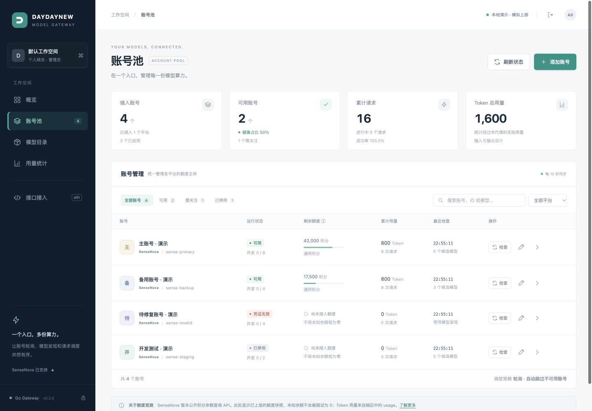

# Web 管理台

管理页面已直接内置到 Go 网关，入口为 `/admin/`，无需额外的前端服务或 Node 运行时。

## 页面与功能

| 页面 | 功能 |
|---|---|
| 概览 | 实例信息、账号可用状态、请求和 Token 汇总、异常账号 |
| 账号池 | 新增、编辑、移除、启停、单号检查、搜索、状态筛选；账号可归入路由分组 |
| 路由分组 | 分组卡片（账号数、聚合模型数、请求/失败、可复制的分组 Base URL）、设为默认、重命名、解散并迁移账号、调度策略切换 |
| 模型目录 | 按分组查看聚合模型，点击模型查看组内聚合详情（候选账号与状态），管理模型别名（model_map）热更新 |
| 用量统计 | 真实累计输入／输出／缓存 Token、请求数、失败及未知 usage |
| 接口接入 | 每个分组一个 Base URL 可直接复制（默认 /v1，其余 /groups/组名/v1），curl 示例随分组切换 |

### 选择平台：logo 卡片

「接入新的账号」**不使用下拉框**，而是把平台渲染成**带 logo 的卡片单选组**（`role="radiogroup"`，支持方向键切换）：

- 平台 logo 是视觉锚点，一眼可辨；平台变多时网格仍可扫视，不会像长下拉列表那样需要逐项读文字。
- 卡片列表由 `GET /admin/v1/info` 的 `platforms` 字段（或 `GET /admin/v1/platforms`）下发，新增平台自动出现，前端无需改动。
- 选中平台后，凭证字段名称／占位符／提示、Base URL 默认值，以及 WorkBuddy 的区域、客户端身份和浏览器 OAuth 面板都会自动切换。
- 编辑已有账号时平台卡片锁定（平台不可更换），并标注「已创建」。
- 没有 logo 的平台自动降级为首字母方块，不会出现空白卡片。

账号详情侧栏提供连接信息、模型状态和额度观测。新增账号保存后立即检查；检查只查询模型发现接口。编辑时 Key 留空保留，输入新 Key 可轮换凭证。页面每 10 秒同步现有状态，后端仍按照配置周期主动检查。

## 启动

使用 [config.admin.example.json](../config.admin.example.json) 可以从空账号池开始，只需在环境变量中配置不同的 `GATEWAY_API_KEY` 和 `GATEWAY_ADMIN_KEY`，然后启动网关。用管理密钥登录网页，再从平台卡片中选择 SenseNova / WorkBuddy / Intern-ai 并添加账号。具体命令见 [README](../README.md#web-管理台)。

网页新增账号保存在 `data/accounts.enc`，使用 AES-256-GCM 加密。默认主密钥文件为 `data/accounts.enc.key`，也支持从 `GATEWAY_ACCOUNT_STORE_KEY` 读取 32 字节标准 Base64 主密钥。数据与密钥文件均以 `0600` 创建；备份时需要保留解密密钥。上游账号凭证不通过管理响应返回。

“接口接入”页默认隐藏代理访问 Key，仅在管理员点击显示或复制时请求 `/admin/v1/client-key`，此接口要求管理密钥并返回 `Cache-Control: no-store`。Key 不写入浏览器存储，隐藏、离开此页或退出后清除页面内存；复制示例会填入当前 Key。要更换客户端 Key，修改启动环境变量 `GATEWAY_API_KEY` 并重启服务。

配置账号仍可使用环境变量；网页编辑会保存覆盖记录，移除会保存删除标记。在线修改和删除有进行中请求的账号会返回 409，避免改变请求正在使用的凭证。加密保存失败不会先激活账号。

状态中的额度与凭证版本关联，换 Key 或源站后不恢复旧凭证的余额。旧版状态中没有凭证关联信息的额度需要重新观测；用量和启停状态继续恢复。

管理密钥只存在当前页面内存，刷新或退出后需要重新登录。页面采用同源 API 与严格 CSP，不加载外部脚本；登录遮罩和详情窗口会隔离背景焦点。

## 额度边界

SenseNova 真实积分余额没有已公开的 API Key 查询接口，页面不会填入估算余额。可手动上报选中的积分池；页面将它标为 `partial=true` 的局部观测，不据此判定未观测积分池已经耗尽。上报会替换旧快照，时间到期后明确显示过期。完整多池自动同步继续使用 `quota_feed_url`。

## 分组路由与聚合路由（网页设置）

- **分组是聚合池的边界**：账号通过「所属分组」归组（账号弹窗的「高级配置」或 config.json 的 `accounts[].group`）。客户端访问 `{origin}/groups/组名/v1` 就固定在这组账号内调度，也可继续使用 `X-Group` 请求头；两种方式等价，路径优先级更高。分组之间账号与聚合模型完全隔离。
- **分组管理**：「路由分组」页以卡片展示每个分组的账号数、启用数、聚合模型数、请求/失败；每个分组显示并可直接复制专属 Base URL（默认分组即 `{origin}/v1`）。支持：设为默认（`default_group` 热更新并写回配置）、重命名（组内账号整体移动、轮询游标重置；若为默认分组会跟随改名）、解散（组内账号移入所选分组，默认分组不可解散）。分组随账号出现，无需预先创建。
- **聚合路由**：「模型目录」页可按分组筛选，目录口径与 `GET /v1/models` 完全一致；点击模型名展开聚合详情（该分组内为此模型提供服务的账号及状态）。模型别名（`middleware.model_map`）可在页面上热增删——客户端写一个虚拟模型名，网关改写为上游真实模型并在响应中回写，保存后立即生效并写回 config.json 的 `middleware` 段。
- **调度策略**：「路由分组」页或「路由 决策」页可切换 round_robin / smart（额度窗口最早重置优先），热更新并写回 config.json 的 `routing` 字段。
- **决策观测**：「路由 决策」页决策时间线增加分组列与筛选，冷却面板按分组可见。

## 验证记录

2026-10-17 已使用本机模拟上游进行浏览器验证，没有使用或保存用户之前提供的真实 Key，也没有生成真实平台用量。

- 管理密钥登录、错误密钥提示、刷新后重新登录。
- 页面添加账号，立即检查并发现模型；编辑名称／并发且保留 Key。
- 搜索与状态筛选、启停、详情、模型、额度上报、删除确认及删除结果。
- 概览、模型目录、用量统计与接口接入导航。
- 桌面断点（1440×1000）与窄屏断点（390×844）；窄屏表格在容器内横向滚动。
- 后端 `go test -race ./...`、`go vet ./...`、JavaScript 语法检查及实际二进制编译均通过。
- 回归测试覆盖加密文件与环境变量引用、篡改拒绝、重启恢复、删除标记、存储失败、进行中请求保护、运行时新增账号的故障切换，以及凭证轮换后的额度隔离。

以下均为明确标注的本地演示数据，演示进程在验证后关闭。

[新增账号预览](assets/admin-add-account.jpg) · [窄屏预览](assets/admin-mobile.jpg)
